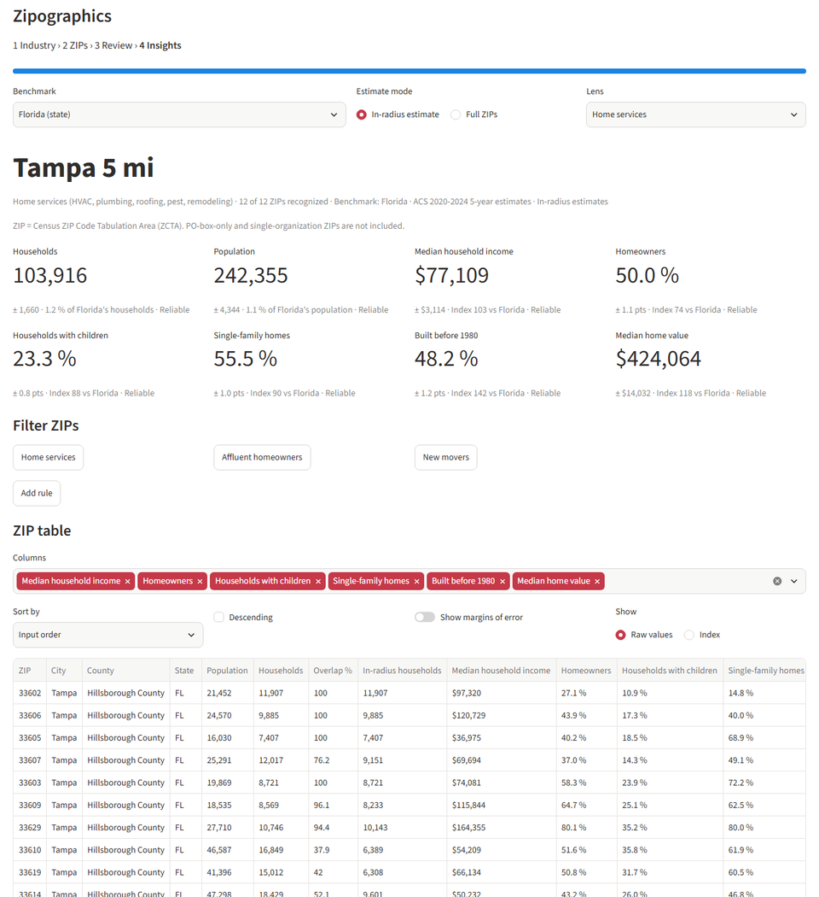
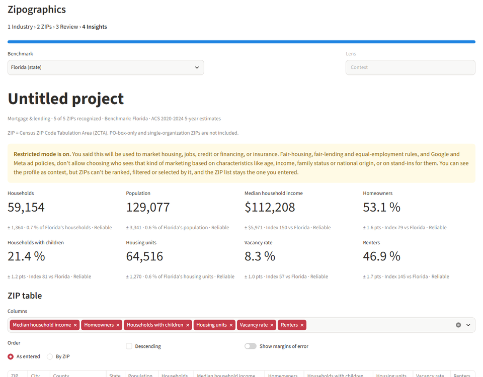

# Zipographics

Give Zipographics a set of US ZIP codes (typed, pasted from Excel, or a
[Zipcator](https://github.com/jpmacolino/project-zipcator) CSV export) and it shows a
**demographic profile of those ZIPs** from U.S. Census Bureau American Community Survey (ACS)
5-year data: KPI cards indexed against a state, county or national benchmark, a ranked and
filterable ZIP table, charts, a map, and exports an account team can hand to a client. It runs
on your own computer; nothing you enter leaves it.



> **"ZIP" here means a Census ZIP Code Tabulation Area (ZCTA).** ZCTAs approximate USPS ZIP
> codes, but PO-box-only and single-organization ZIP codes have no ZCTA and are not included
> (they are reported as "not found"). ACS figures are survey **estimates with margins of error**,
> not exact counts (see [Reading the numbers](#reading-the-numbers)).

## Setup

You need [`uv`](https://docs.astral.sh/uv/) (it installs the right Python for you; Python 3.11 or
newer is supported). On Windows: `powershell -c "irm https://astral.sh/uv/install.ps1 | iex"`.

1. **Install:** `uv sync`
2. **Get a free Census Data API key** at <https://www.census.gov/data/developers/api-key.html>.
   Copy the example environment file to `.env` and paste the key after `CENSUS_API_KEY=`.
   **The key is used only by the one-time data build.** The app never reads it and never calls
   the Census API: once `data/` is built you can delete `.env`, or copy the built `data/` folder
   to another computer and run the app there with no key.
3. **Build the data once:** `uv run python scripts/build_data.py`. It downloads the ACS tables
   (about 60 polite requests, a minute or two with a warm cache), the ZCTA boundaries and the
   ZCTA-to-county relationship file, and writes `data/` (about 50 MB, plus about 200 MB of cached
   downloads in `data/raw/`). Options: `--refresh` (ignore cached downloads), `--vintage 2024`,
   `--only acs|geo`, `--no-geo`, `--tolerance` (map simplification), `--data-dir`.
4. **Run the app:** `uv run streamlit run app/streamlit_app.py`

If the data has not been built the app says so and shows the command to run.

## Using the app

1. **Industry.** Pick the client's industry (it sets the default lens) and answer the question
   *"Will this be used for ads, mailers, or any other marketing for housing, jobs, credit or
   financing, or insurance?"* A **Yes** turns on [restricted mode](#restricted-mode). Some
   industries (real estate, lending, insurance, staffing...) are always restricted. Optionally
   name the project: the name titles the dashboard and every export.
2. **ZIPs.** Paste or type ZIPs (any mix of commas, spaces, tabs, new lines; up to 1,000), or
   upload a CSV. Leading zeros that Excel dropped are restored (`2108` becomes `02108`) and
   reported; ZIP+4 values are cut to 5 digits; junk is listed back to you.
   A **Zipcator export** is detected automatically and turns on *in-radius estimates*: each ZIP
   counts in proportion to how much of it lies inside your radius.
3. **Review.** A short summary of what was recognized, repaired, not found (and why), small
   populations, states spanned. Nothing is built until you continue.
4. **Insights.** KPI cards, a ranked ZIP table, a map and charts compared with a benchmark
   (default: the state holding most of your ZIPs' population; switch to a county or the nation).
   Lenses choose which figures lead (home services, restaurants, retail, health, ...).
   Filters and presets ("Affluent homeowners", "Families", ...) highlight the ZIPs that match.
5. **Export.** A ZIP list for ad platforms, the table as CSV (plain, or *for Excel*), and a
   self-contained HTML summary report that prints cleanly to PDF.

### Command line

```
uv run zipographics profile 33602 33606 02108 --vertical "Home services" --restricted no \
    --project "Acme HVAC" --csv acme.csv --report acme.html
```

Same library code as the app. `--restricted yes|no` is required unless the industry is always
restricted; `--file zips.csv` reads ZIPs (or a Zipcator export) from a file; `--benchmark
state|county|us`; `--excel` makes the CSV the Excel-safe variant.

## Reading the numbers

- **Margins of error.** Every ACS estimate has a margin of error at the 90 % confidence level.
  Zipographics shows `+/-` margins and a reliability tier from the coefficient of variation
  (margin / 1.645 / estimate): **reliable** up to 15 %, **use with caution (`~`)** 15-30 %,
  **unreliable (`†`)** above 30 %. The tier is never only a colour. Margins of sums, shares and
  ratios across several ZIPs follow the Census Bureau's handbook formulas and are
  *approximations*, as are in-radius estimates; the exports say so.
- **Medians are never averaged.** For several ZIPs the median is interpolated from the summed
  bracket counts; for one ZIP it is the published median. A top-coded median shows as
  "$250,000+" (a bound), with no index.
- **Index.** 100 = the benchmark; 128 means 28 % above it. Counts show their share of the
  benchmark's total instead.
- **Filters compare what the table shows** (a share displayed as 25.0 % meets "25 %").

## Restricted mode

Marketing for housing, jobs, credit or financing, or insurance must not target people by
protected characteristics (race, national origin, family status, age, sex, disability, ...) or
by stand-ins for them. Zipographics asks up front and, when it applies, keeps the profile
visible **as context** but refuses to rank, filter, highlight or select ZIPs by it, in the
**library** as well as the screen: the table is static and in input order, the map has one
neutral fill, the ZIP list is exactly the ZIPs you entered, and the exports say restricted mode
was on. It is stricter than the legal list on purpose: at ZIP level nearly every ACS measure
correlates with a protected class. Ad platforms (Google, Meta) add their own limits; check their
current rules before uploading a list.

> **Restricted mode is a guardrail, not legal advice. It does not make a campaign compliant.
> The agency's counsel should review the industry-to-restricted mapping and the restricted
> characteristic list before wide internal use.** Both live in one place each:
> `src/zipographics/verticals.py` and `src/zipographics/restricted.py`.



## Exports and the CSV footer

- **ZIP list:** comma-separated or one per line, no header or footer (it must paste and upload
  cleanly). The attestation shown above it is recorded in the CSV and the report.
- **CSV:** one row per ZIP, then a `Trade area` row and a `Benchmark` row (the `Row type`
  column keeps the `ZIP` column pure). ZIPs are text. **CSV for Excel** has a UTF-8 BOM and
  writes ZIPs as `="02108"` so Excel keeps the leading zero.
- **How to read the footer.** After the table there is one blank line, then one line per fact,
  each a single quoted cell starting with `Note:` (project, industry, the restricted-use
  question and your answer, benchmark, filters, data vintage, the ZCTA and margin-of-error
  notes, a timestamp and the attribution). In a spreadsheet it sits at the bottom. A program
  reads the table by stopping at the blank line, for example:

  ```python
  import pandas as pd
  n_notes = sum(1 for line in open("acme.csv", encoding="utf-8-sig") if line.startswith('"Note:'))
  table = pd.read_csv("acme.csv", dtype=str, keep_default_na=False, encoding="utf-8-sig",
                      skipfooter=n_notes + 1, engine="python")  # dtype=str keeps the ZIP zeros
  ```

- **Report:** one HTML file with no scripts or external requests: open it in any browser;
  Print > Save as PDF gives a clean PDF.

## Data sources and attribution

This product uses the Census Bureau Data API but is not endorsed or certified by the Census
Bureau.

- **ACS 5-year estimates** (currently 2020-2024), U.S. Census Bureau, via the Census Data API.
  Public domain. The vintage is recorded in `data/metadata.json` and shown in the app.
- **ZIP Code Tabulation Areas:** 2020 cartographic boundary file (500k), U.S. Census Bureau;
  the 2020 ZCTA-to-county relationship file picks each ZCTA's primary county. Public domain.
  Map shapes are simplified for display and are indicative only.
- **City names** come from [GeoNames](https://www.geonames.org/) (`US` and `PR` postal-code
  files), licensed [CC BY 4.0](https://creativecommons.org/licenses/by/4.0/).
- Map tiles are loaded by your browser from OpenStreetMap (© OpenStreetMap contributors); the
  app itself makes no network request.

## Development

```
uv run pytest                          # default suite: unit, property, UI (AppTest); no network
uv run pytest -m data                  # needs the built data/: integration + the 8 golden scenarios
uv run pytest -m slow -s               # performance budgets with timings
uv run pytest -m visual                # Playwright screenshots into qa/screenshots/ (see below)
uv run python scripts/check.py         # every gate: ruff, mypy, tests + coverage, size, secrets,
                                       #   encoding, and mypy + tests again on Python 3.11
```

- Visual QA setup (once): `uv sync --group visual` then `uv run playwright install chromium`.
- Property tests use Hypothesis profiles: `HYPOTHESIS_PROFILE=thorough` for a deep run; CI sets
  `CI` and gets the `ci` profile automatically.
- `uv run pytest -m network` makes a few live Census API calls (needs the key; run sparingly).
- Design and decisions: [docs/SPEC.md](docs/SPEC.md), [docs/DECISIONS.md](docs/DECISIONS.md),
  [docs/QA_REPORT.md](docs/QA_REPORT.md). All logic lives in `src/zipographics`; the Streamlit
  file is layout and wiring only.
- Never commit `.env`, `data/` contents or `qa/screenshots/` (all ignored).

## License

MIT; see [LICENSE](LICENSE).
